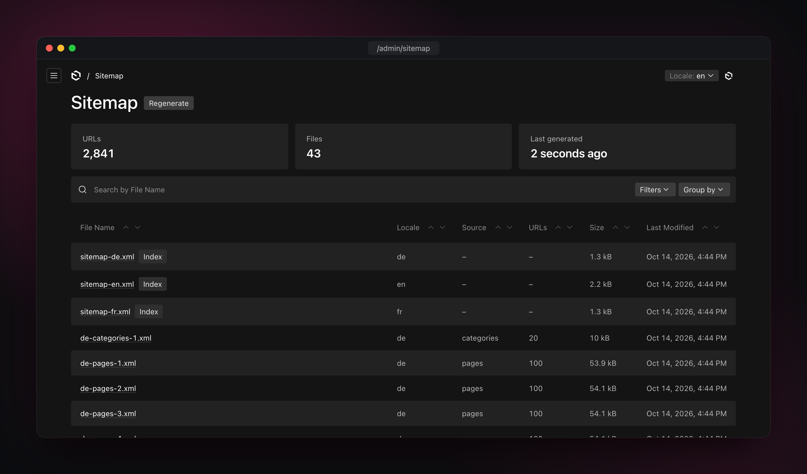
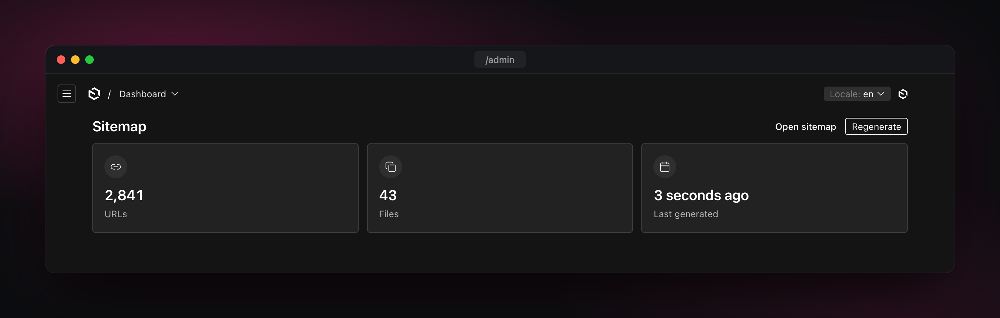

<div align="center">

<picture>
  
</picture>

<h1>Sitemap for Payload</h1>

<p>Build sitemap.xml from your Payload content, store them in any storage, and keep them fresh.</p>

<a href="https://github.com/maximseshuk/payload-plugin-sitemap/releases/"></a>
<a href="https://www.npmjs.com/package/@seshuk/payload-plugin-sitemap"></a>
<a href="https://www.npmjs.com/package/@seshuk/payload-plugin-sitemap"></a>
<a href="https://github.com/maximseshuk/payload-plugin-sitemap/actions/workflows/ci.yml"></a>
<a href="https://github.com/maximseshuk/payload-plugin-sitemap/blob/main/LICENSE"></a>
<a href="https://ko-fi.com/seshuk"></a>

</div>

## Contents

- **[Getting started](#getting-started):** [Versions](#versions), [Quick start](#quick-start), [How it works](#how-it-works)
- **[Configuration](#configuration):** [Options](#options), [Sources](#sources), [Output](#output), [Multi-tenant](#multi-tenant)
- **[Running and serving](#running-and-serving):** [Storage](#storage), [Publish](#publish), [Jobs](#jobs), [Admin page and widget](#admin-page-and-widget), [Endpoints](#endpoints)
- **[Recipes](#recipes):** [Serve on your site domain](#serve-on-your-site-domain), [robots.txt](#robotstxt), [Run from code](#run-from-code), [Large sites](#large-sites)
- **More:** [Telemetry](#telemetry), [Related plugins](#related-plugins), [Support](#support)

## Features

- **Index and child sitemaps.** Split at the spec limits (50,000 URLs or 50 MB), with images and hreflang.
- **Any source.** Collections, static pages and your own URL lists in one `sources` array. `url: '/blog/:slug'` is enough.
- **Only public pages.** By default, read as an anonymous visitor. Drafts are never listed.
- **Editors in control.** Exclude a page or set its priority right in the document.
- **Locales and tenants.** A domain per locale, and a sitemap per tenant.
- **Any storage.** S3, R2, Bunny, Vercel Blob, local disk or your own `upload`. Optional publish to a CDN.
- **Fresh and safe.** Edits queue one job, unchanged files are skipped, and a failed run keeps the old files online.
- **Admin page and widget.** Status, file table and a **Regenerate** button, in every language Payload ships.

## Screenshots

The Sitemap page, with the last run and the file table:



The dashboard widget:



## Getting started

### Versions

| Plugin | Payload | Node.js | Install                               |
| ------ | ------- | ------- | ------------------------------------- |
| 1.x    | 4       | 24.15+  | `@seshuk/payload-plugin-sitemap@beta` |
| 0.x    | 3       | 22+     | `@seshuk/payload-plugin-sitemap@0`    |

- 1.x is in beta under the `beta` npm tag while Payload 4 is in beta.
- 0.x needs Payload 3.83 or later, with `@payloadcms/next` (every Payload 3 Next.js app has it).
- Until 1.0.0, 0.x gets the same features as 1.x. After that, it gets only critical and high-severity security fixes. See [SECURITY.md](SECURITY.md).

### Quick start

#### Install

```bash
# Payload 4
pnpm add @seshuk/payload-plugin-sitemap@beta

# Payload 3
pnpm add @seshuk/payload-plugin-sitemap@0
```

#### Configure

The smallest setup lists one collection with a URL pattern:

```ts
import { sitemap } from '@seshuk/payload-plugin-sitemap'
import { buildConfig } from 'payload'

export default buildConfig({
  // ...
  jobs: {
    autoRun: [{ cron: '* * * * *', queue: 'default' }],
  },
  plugins: [
    sitemap({
      siteUrl: 'https://example.com',
      sources: [{ type: 'collection', collection: 'posts', url: '/blog/:slug' }],
    }),
  ],
})
```

A fuller example:

```ts
sitemap({
  siteUrl: 'https://example.com',
  sources: [
    { type: 'static', entries: [{ url: '/', priority: 1 }, { url: '/contact' }] },
    {
      type: 'collection',
      collection: 'pages',
      url: ({ doc }) => (doc.slug === 'home' ? '/' : `/${doc.slug}`),
      changefreq: 'weekly',
      priority: ({ doc }) => (doc.slug === 'home' ? 1 : 0.8),
      fields: true,
    },
    {
      type: 'collection',
      collection: 'posts',
      url: '/blog/:category.slug/:slug',
      images: ['cover', 'gallery.image'],
      query: { where: { hidden: { not_equals: true } }, sort: '-publishedAt' },
    },
  ],
  jobs: { regenerate: { delay: 10_000 } },
})
```

#### Next steps

1. Run `payload generate:importmap`, so the admin panel can find the Sitemap page and widget.
2. Make sure something runs jobs. Generation runs as a Payload job. Use `jobs.autoRun` as above, `payload jobs:run` on a cron, or your own worker. Without a runner, jobs stay in the queue. To work without the jobs queue, see [Without Payload jobs](#without-payload-jobs).

The first run happens after the first change, or when you press **Regenerate** on the Sitemap page.

### How it works

1. A document in a listed collection is created, changed or deleted.
2. The plugin queues a `sitemap-generate` job. The job waits `jobs.regenerate.delay` (5 minutes by default). More changes in that time join the same job.
3. The job takes the run lock and reads every source in order. It writes the XML and uploads only the files that changed. Each file is one document in the files collection.
4. When every file is stored, one write to the hidden `sitemap-status` global switches the endpoints to the new files.
5. With `publish`, the changed files then go to their public keys.
6. Files that are no longer needed are removed.
7. The endpoints look up a file by name and send it.

If the run fails before the switch, it removes the files it stored, and the previous files stay online.

#### What gets listed

- **Published documents only.** Drafts are never listed. In a collection with drafts, only published documents are listed. With Payload's `localizeStatus`, the status is kept per locale. A document is then listed in a locale only when it is published in that locale. Saving a draft that was never published does not queue a run.
- **Public documents only.** Documents are read as an anonymous visitor (`overrideAccess: false`, no user). The collection's own `read` access decides what is public, so members-only or tenant-scoped documents stay out.
- **Default access lists nothing.** Payload's default access allows only logged-in users, so such a collection lists nothing. Give it public read access, for example `access: { read: () => true }`, or set `query: { overrideAccess: true }` for that source.
- **Tenants are not split by default.** With the multi-tenant plugin, an anonymous read is not limited to one tenant. Without the [`tenants`](#multi-tenant) option, every tenant's documents end up in one sitemap.

## Configuration

### Options

Every option is checked when Payload starts. An unknown key, a wrong type or a value out of range stops Payload from starting, with an error that names the option.

| Option      | Type                                            | Default  | What it does                                                                                          |
| ----------- | ----------------------------------------------- | -------- | ----------------------------------------------------------------------------------------------------- |
| `siteUrl`   | `string \| ({ locale, req, tenant }) => string` | required | Public site address. A function can give each locale or tenant its own domain. See [Output](#output). |
| `sources`   | `SitemapSource[]`                               | `[]`     | What the sitemap lists: collections, static pages and custom URL lists. See [Sources](#sources).      |
| `output`    | `SitemapOutputOptions`                          | `{}`     | File size, file names, file URLs, hreflang and one index per locale. See [Output](#output).           |
| `storage`   | `SitemapStorageOptions`                         | `{}`     | Where the files are stored. See [Storage](#storage).                                                  |
| `publish`   | `SitemapPublishOptions`                         |          | Also write every file to a stable public key. See [Publish](#publish).                                |
| `tenants`   | `boolean \| SitemapTenantsOptions`              | `false`  | One sitemap per tenant for the multi-tenant plugin. See [Multi-tenant](#multi-tenant).                |
| `jobs`      | `false \| SitemapJobsOptions`                   | `{}`     | When generation runs. `false` uses no jobs queue. See [Jobs](#jobs).                                  |
| `admin`     | `SitemapAdminOptions`                           | `{}`     | Sitemap page, widget and who can use them. See [Admin page and widget](#admin-page-and-widget).       |
| `enabled`   | `boolean`                                       | `true`   | `false` turns the plugin off but keeps its database schema. See below.                                |
| `telemetry` | `boolean \| { url? }`                           | `true`   | Anonymous usage telemetry. See [Telemetry](#telemetry).                                               |

Each group has its own exported type, such as `SitemapCollectionSource`, `SitemapOutputOptions` or `SitemapStorageOptions`. Your editor shows the docs for each field.

With `enabled: false` (useful in development):

- The files and locks collections, the status global, the fields and the task stay in the schema, so the database schema does not change.
- The plugin adds no hooks, endpoints, page or widget, and sends no telemetry.
- The task does nothing.

### Sources

`sources` is one array. Each source has a `type` and writes its own files, named after the source: `pages-1.xml`, `pages-2.xml`. The index lists the files in the order of the array.

```ts
sources: [
  { type: 'static', entries: [{ url: '/' }, { url: '/contact' }] },
  { type: 'collection', collection: 'pages' },
  { type: 'collection', collection: 'posts', url: '/blog/:slug' },
  { type: 'custom', name: 'catalog', entries: catalogEntries },
]
```

- `name` is the file name part: letters, digits, `-` and `_`. It defaults to the collection slug, or to `static`.
- Every name must be unique.
- You can list the same collection more than once with different names, for example with a different `query.where`. Only one of those sources may set `fields`.

#### Collections

| Key          | Type                                                                  | Default       | What it does                                                                      |
| ------------ | --------------------------------------------------------------------- | ------------- | --------------------------------------------------------------------------------- |
| `collection` | `string`                                                              | required      | Slug of the collection.                                                           |
| `name`       | `string`                                                              | the slug      | File name part.                                                                   |
| `url`        | `string \| ({ doc, locale, req, siteUrl, tenant }) => string \| null` | `'/:slug'`    | URL pattern with `:field` placeholders, or a function.                            |
| `locales`    | `string[]`                                                            | every locale  | Locales to write this collection for.                                             |
| `lastmod`    | `string \| false \| ({ doc }) => Date \| string`                      | `'updatedAt'` | Field with the last change date, `false` to leave `<lastmod>` out, or a function. |
| `changefreq` | [static value or function](#static-value-or-function)                 |               | `always`, `hourly`, `daily`, `weekly`, `monthly`, `yearly` or `never`.            |
| `priority`   | [static value or function](#static-value-or-function)                 |               | From 0 to 1.                                                                      |
| `images`     | `(string \| { field, url } \| fn)[] \| fn`                            |               | Image field paths, functions, or both. See [Images](#images).                     |
| `fields`     | `boolean \| { exclude, priority, changefreq, position }`              | `false`       | Add per-document fields. See [Sitemap fields](#sitemap-fields).                   |
| `query`      | `{ where, depth, select, sort, overrideAccess }`                      |               | Options for reading the documents. See [Query](#query).                           |

```ts
{
  type: 'collection',
  collection: 'products',
  url: '/shop/:category.slug/:slug',
  lastmod: 'meta.publishedAt',
  changefreq: 'daily',
  priority: ({ doc }) => (doc.featured ? 1 : 0.6),
  images: [{ field: 'gallery.image', url: (image) => `https://img.example.com/${image.filename}` }],
  query: { where: { stock: { greater_than: 0 } } },
}
```

With generated types, `doc` in every function has the type of that collection.

##### URL pattern

A `url` string fills each `:field` placeholder from the document.

- Nested fields work: `:category.slug` reads `doc.category.slug`. This goes through groups, named tabs and relationships. A relationship placeholder needs `depth` 1, and the plugin sets it for you.
- A relationship to several collections works the same way: `:vendor.slug` reads the related document.
- String and number values work, such as text, select, date or number fields. Any other value, such as a checkbox or a `hasMany` list, leaves the document out.
- Values are URL-encoded. A `/` inside a value is kept.
- A document with an empty or missing placeholder value is left out.
- `:locale` is the locale of the URL: `/:locale/blog/:slug`. It needs localization, or Payload does not start.
- Put a placeholder in braces when text follows it directly: `/:{slug}.html`. Without braces, `:slug.html` reads the nested field `slug.html`.
- A relative result is joined to `siteUrl`.
- A URL that starts with `//` keeps its host and takes the protocol of `siteUrl`.

##### URL function

Use a function for anything a pattern cannot express. It gets the document, the locale, `req`, the tenant and the `siteUrl` of that locale. It can return:

- a path such as `/de/kontakt`, which is joined to `siteUrl`;
- an absolute URL, which is kept as it is;
- `null`, which leaves the document out.

##### Query

`query` goes to `payload.find`. Documents are read 250 at a time.

- `where` filters the documents. Drafts are skipped anyway, but a `where` on `_status` still applies.
- `depth` defaults to 0. It is 1 when `images` uses field paths or the `url` pattern has a nested placeholder.
- With `select`, the plugin adds the fields that the `url` pattern, `lastmod`, `images`, `sort` and the sitemap fields need.
- `overrideAccess: true` reads every document and ignores the collection's `read` access. Use it only when the collection's access does not describe what is public.

##### Sort

`query.sort` sets the order of the URLs. It defaults to `id`. Put `-` in front for descending order: `sort: '-publishedAt'`.

- It takes a top-level field that is not localized: text, textarea, email, number, date, single select, radio, checkbox or code. It also takes `id`, `createdAt` and `updatedAt`. Any other field stops Payload from starting, with an error.
- With generated types, `sort` takes only the field names of that collection, so your editor suggests them. Localized fields still pass the type check, but stop Payload from starting.
- Documents without a value come last, in `id` order.
- The plugin pages with a cursor on the sort value and `id`, so equal values never lose or repeat a document.
- A document whose sort value changes during a run can move past the read position and miss that run. For example, `updatedAt` changes when someone saves the document while the run reads. The save queues a new run, which lists the document again.

#### Static value or function

`changefreq` and `priority` take a static value, or a function of the document:

```ts
priority: ({ doc }) => (doc.featured ? 1 : 0.6),
changefreq: async ({ doc, locale, req }) => (await isOnSale(doc, req)) ? 'daily' : 'monthly',
```

- The function gets `{ doc, locale, req }` and may be async.
- If it returns `undefined`, the tag is left out for that document.
- With [sitemap fields](#sitemap-fields), a value that an editor sets on the document wins over the source value.
- If a function or a sitemap field gives a priority outside 0 to 1, that document gets no `<priority>` tag, and a warning is logged. A static value outside that range stops Payload from starting.

`lastmod` works the same way: a field name, `false`, or a function that returns a date.

Static and custom sources set their tags per entry, so these rules do not apply to them.

#### Images

```ts
images: ['cover', 'hero.image', 'gallery.image', { field: 'layout.media', url: (image) => image.sizes?.large?.url }]
```

- A field path can go through groups, named tabs, arrays and blocks: `gallery.image` reads `image` from every row of `gallery`.
- Upload fields with `hasMany`, or with several collections in `relationTo`, give one image per file.
- An upload document gives its `url`. Pass `url` to build the URL yourself, for example for an image CDN. Return `null` to skip an image.
- A plain string value is used only when it is an absolute URL.
- A relative URL (starting with `/`, as Payload writes for local files) is resolved against the Payload `serverURL`. Without `serverURL`, it is skipped.
- Each image URL is written once per page. Only the first 1000 images per page are kept.

A function gets `{ doc, locale, req }`, may be async, and returns URLs:

```ts
images: ({ doc }) => doc.photos.map((photo) => photo.src)
```

Field paths and functions can share one array, and the results are merged:

```ts
images: ['cover', ({ doc }) => doc.externalPhotos ?? []]
```

When the array has only functions, `depth` stays 0, so upload fields come as IDs. Set `query.depth` if a function needs the upload documents.

#### Sitemap fields

Sitemap fields let editors control one document:

- **Exclude from sitemap** (`exclude`) leaves the document out.
- **Priority** (`priority`, 0 to 1) and **Change frequency** (`changefreq`) override the source value for this document.

```ts
fields: true
fields: { exclude: true }
fields: { exclude: true, priority: true, position: { after: 'featured' } }
```

- `true` adds all three. An object adds only the keys set to `true`. `false` or no `fields` adds nothing.
- One field is added on its own. Two or more go into an unnamed **Sitemap** group, so the stored names stay `sitemapExclude`, `sitemapPriority` and `sitemapChangefreq`.
- Labels are translated into every language Payload ships.
- A change to these fields queues a run, like any other change.
- On SQL databases, create a migration after you add the fields.

##### Placing the fields

`position` takes `'sidebar'` (default), `'first'`, `'last'`, `{ after: 'path' }` or `{ before: 'path' }`.

- A path goes through named groups, arrays and named tabs, such as `meta.description`.
- A unique last segment is enough: `description`.
- An unknown or ambiguous path stops Payload from starting, with an error that names the collection.

You can place the fields in three ways:

1. **Let the plugin add them.** `fields: true` puts a Sitemap group in the sidebar.

2. **Next to another field**, with `position`:

   ```ts
   plugins: [
     seoPlugin({ collections: ['pages'], tabbedUI: true }),
     sitemap({
       siteUrl: 'https://example.com',
       sources: [
         {
           type: 'collection',
           collection: 'pages',
           fields: { exclude: true, position: { after: 'meta.description' } },
         },
       ],
     }),
   ]
   ```

   A field from another plugin, such as the `meta` group of the SEO plugin, exists only when that plugin comes before `sitemap` in `plugins`.

3. **Anywhere you like**, with the builders from `@seshuk/payload-plugin-sitemap/fields`. Leave `fields` out for that collection:

   ```ts
   import { sitemapFields } from '@seshuk/payload-plugin-sitemap/fields'

   seoPlugin({
     collections: ['pages'],
     fields: ({ defaultFields }) => [...defaultFields, ...sitemapFields()],
   })
   ```

   `sitemapFields({ exclude: true })` picks the fields. `sitemapExcludeField()`, `sitemapPriorityField()` and `sitemapChangefreqField()` give one field each.

The plugin always reads fields marked with `custom: { sitemap: 'exclude' | 'priority' | 'changefreq' }`, wherever they are in the collection. The builders set this marker. If a collection already has marked fields, adding `fields` to its source stops Payload from starting, with an error.

#### Static pages

```ts
{ type: 'static', entries: [{ url: '/', priority: 1, changefreq: 'daily' }, { url: '/contact' }, { url: 'https://shop.example.com/' }] }
```

- A `url` that starts with `/` or has no scheme is joined to `siteUrl`. An absolute URL is kept.
- The entries go to `static-1.xml`, or to `<name>-1.xml` when you set `name`.

To vary the entries by locale, pass a function. It is called once per locale, and the same `url` from two locales is written once:

```ts
{ type: 'static', entries: ({ locale }) => [{ url: `/${locale}` }, { url: `/${locale}/contact` }] }
```

#### Custom sources

```ts
{
  type: 'custom',
  name: 'catalog',
  locales: ['en', 'de'],
  entries: async function* ({ locale, req, siteUrl }) {
    const categories = await req.payload.find({ collection: 'categories', limit: 0, locale, req })
    for (const category of categories.docs) {
      yield { url: `/catalog/${category.slug}`, changefreq: 'weekly' }
    }
  },
}
```

- `name` is required.
- `entries` is called once per locale in `locales` (every locale by default). It can return an array, a promise of an array, or an async generator for long lists.
- A relative `url` is joined to `siteUrl`. An entry with a scheme other than http(s) is skipped with a warning.
- Add the collections the source reads to `jobs.regenerate.collections`, so changes there queue a run too.

### Output

| Key              | Type                                                 | Default                           | What it does                                                       |
| ---------------- | ---------------------------------------------------- | --------------------------------- | ------------------------------------------------------------------ |
| `maxUrlsPerFile` | `number`                                             | `50000`                           | URLs per file. Files also roll over before 50 MB.                  |
| `filename`       | `({ kind, locale, part, source, tenant }) => string` | see [File names](#file-names)     | Name of each file. May contain folders.                            |
| `fileUrl`        | `({ filename, locale, siteUrl, tenant }) => string`  | `${siteUrl}/sitemaps/${filename}` | Public URL of a child sitemap, written into the index.             |
| `hreflang`       | `boolean`                                            | `true`                            | Add alternates and `x-default` when there is more than one locale. |
| `splitLocales`   | `boolean`                                            | `false`                           | Write one index per locale (`sitemap-de.xml`, `de-pages-1.xml`).   |

#### hreflang

With localization on, every URL is written once per locale. Each one gets `xhtml:link` alternates for the other locales and an `x-default` that points to the default locale. Alternates are written only when a page has at least two language versions.

#### Site URL per locale

For one domain per locale, pass a function as `siteUrl`:

```ts
sitemap({
  siteUrl: ({ locale }) => (locale === 'de' ? 'https://example.de' : 'https://example.com'),
  output: { splitLocales: true },
  // ...
})
```

The function also gets `req` and may be async, so the address can come from a global or a tenant:

```ts
siteUrl: async ({ req }) => (await req.payload.findGlobal({ slug: 'settings', req })).siteUrl,
```

- It is called once per locale (and per tenant, with `tenants`) at the start of each run.
- With `splitLocales`, `/api/sitemap.xml?locale=de` returns the index for that locale.

#### File names

`filename` gets:

- `kind`: `index` or `file`;
- `locale`: only with `splitLocales`;
- `tenant`: only with `tenants`;
- `source` and `part` (from 1): only for a child file.

The default names are `sitemap[-<tenant id>][-<locale>].xml` for an index and `[<tenant id>-][<locale>-]<source>-<part>.xml` for a file.

```ts
output: {
  splitLocales: true,
  filename: ({ kind, locale, part, source }) =>
    kind === 'index' ? `${locale}/sitemap.xml` : `${locale}/${source}-${part}.xml`,
}
```

Rules for names:

- A name may contain `/` for folders. Each part of the path uses letters, digits, `.`, `-` and `_`. The name ends in `.xml`.
- A child file must be in the folder of its index or below, as the sitemap protocol asks.
- Every name must be unique. The run checks this before it stores anything, and stops with an error that names the file.
- The endpoints serve nested names as they are: `/api/sitemaps/en/pages-1.xml`. `/api/sitemap.xml` always returns the index, whatever its name.
- Payload does not allow `/` in upload file names, so the upload collection replaces `/` with `_`: `en_pages-1.3f2a9c1b7e4d.xml`. A custom `storage.upload` gets the name with its folders: `en/pages-1.3f2a9c1b7e4d.xml`.

### Multi-tenant

With [`@payloadcms/plugin-multi-tenant`](https://payloadcms.com/docs/plugins/multi-tenant), turn on `tenants` and build `siteUrl` from the tenant document:

```ts
sitemap({
  siteUrl: ({ tenant }) => `https://${tenant?.domain}`,
  sources: [
    { type: 'collection', collection: 'pages' },
    { type: 'collection', collection: 'posts', url: '/blog/:slug' },
  ],
  tenants: true,
})
```

| Key          | Type     | Default     | What it does                                                                       |
| ------------ | -------- | ----------- | ---------------------------------------------------------------------------------- |
| `collection` | `string` | `'tenants'` | Slug of the tenants collection.                                                    |
| `field`      | `string` | `'tenant'`  | Name of the tenant relationship field on documents.                                |
| `where`      | `Where`  |             | Only tenants that match get a sitemap, for example `{ active: { equals: true } }`. |

`true` uses the multi-tenant plugin's defaults.

#### How a run works with tenants

- The run reads the tenants collection with access control off. Every tenant gets its own sitemap, except tenants left out by `where`. If the tenants collection has drafts, draft tenants are skipped too.
- For each tenant, the run calls `siteUrl` with `{ locale, req, tenant }` and writes a separate index and files.
- The files are named after the tenant id: `sitemap-<id>.xml`, `<id>-pages-1.xml`. With `output.splitLocales`, the locale follows the id: `sitemap-<id>-de.xml`.
- A collection with the tenant field (a relationship to the tenants collection) lists only that tenant's documents.
- A collection without it, such as shared legal pages, is read again for every tenant and listed in every tenant's sitemap.
- Static and custom `entries`, a collection `url` function, `output.filename` and `output.fileUrl` also get `tenant`, so they can return different URLs per tenant.
- A change to a tenant, such as a new domain, queues a run, like a change to a listed collection.

#### Endpoints and proxy

- Ask for a tenant's index with `/api/sitemap.xml?tenant=<id>`. Without a tenant, the endpoint returns 404.
- On the site, pass `tenant` to `sitemapProxy` to pick the tenant from the host name. See [Serve on your site domain](#serve-on-your-site-domain).
- Child files already have the tenant id in their names. The proxy returns 404 for child files of other tenants.

#### Setup notes

- Tenant ids go into the default file names, so they may use only letters, digits, `-` and `_`. The default ids of every database adapter do.
- Two files must not get the same name. For example, tenant `eu` with a source `news-pages` and tenant `eu-news` with the `pages` collection both give `eu-news-pages-1.xml`. The run then fails before it writes anything.
- At start, the plugin checks that at least one listed collection has the `field` as a relationship to the tenants collection.
- Turning `tenants` on adds a `tenant` column to the files collection. On SQL databases, create a migration.

## Running and serving

### Storage

| Key          | Type                                                | Default                     | What it does                                                                                           |
| ------------ | --------------------------------------------------- | --------------------------- | ------------------------------------------------------------------------------------------------------ |
| `collection` | `CollectionOverride`                                | `{ slug: 'sitemap-files' }` | Changes to the files collection: `slug`, `access`, `admin`, `upload`, and `fields({ defaultFields })`. |
| `upload`     | `({ body, contentType, filename, req }) => { url }` |                             | Upload the files yourself. The files collection then keeps only the file list.                         |
| `delete`     | `({ filename, req, url }) => unknown`               |                             | Delete a file from your storage when a run no longer needs it. Needs `upload`.                         |

#### The files collection

By default, files go into the `sitemap-files` upload collection.

- It is hidden in the admin panel. Nobody can create, change or delete its documents through the API.
- Each stored file name ends with a short hash of its content, such as `posts-1.3f2a9c1b7e4d.xml`, so a new version never overwrites the file that crawlers are reading.
- The endpoints and the sitemap index always use the plain name (`posts-1.xml`). The endpoints send the file themselves.

In Payload 3, configure your storage adapter for it in the `plugins` list, like any other upload collection:

```ts
export default buildConfig({
  // ...
  plugins: [
    s3Storage({
      collections: { media: true, 'sitemap-files': true },
      // ...
    }),
  ],
})
```

You rarely need to change it. `collection` takes any collection key, and each key you pass replaces the plugin's value. Common cases:

- `slug`: the name `sitemap-files` is taken, or does not fit your naming.
- `admin`: show the file list in the admin panel. It is hidden by default.
- `access`: choose who can read the file list through the API. By default, the people who can open the [admin page](#admin-page-and-widget).
- `upload`: change the upload settings, for example `staticDir`, the folder on disk when no storage adapter handles the collection.
- `fields`: gets the plugin's fields and returns the new list.

```ts
storage: {
  collection: {
    slug: 'seo-files',
    admin: { hidden: false, useAsTitle: 'name' },
  },
}
```

#### Your own storage

To keep the files out of Payload, pass `upload`. Use it for your own bucket, Bunny Storage or a folder on disk. The files collection then has no uploads and only keeps the file list. `collection` still works, except `collection.upload`.

```ts
storage: {
  upload: async ({ body, contentType, filename }) => {
    await bucket.put(`seo/${filename}`, body, { contentType })
    return { url: `https://cdn.example.com/seo/${filename}` }
  },
  delete: async ({ filename }) => {
    await bucket.delete(`seo/${filename}`)
  },
}
```

**`upload`**

- It gets the file as a `Buffer`, with its name and content type. It returns the URL where the file can be read.
- The endpoints fetch the file from this URL and send it.
- A relative URL is resolved against the Payload `serverURL`. Without `serverURL`, the run fails.
- Only changed files are uploaded. `filename` ends with a hash of the content (`posts-1.3f2a9c1b7e4d.xml`), so each version gets a new name and nothing is overwritten.
- Folders from `output.filename` are kept: `en/posts-1.3f2a9c1b7e4d.xml`.
- If `upload` throws or returns no `url`, the run fails and the previous files stay listed.

**`delete`** is optional. It gets the same `filename` and the `url` that `upload` returned.

- It is called after the endpoints switch to the new files. It runs once for each old version and for each file the run no longer writes, such as `posts-3.xml` after the posts fit in two files.
- When a run fails, it is called for the files that run already uploaded.
- If the process stops in the middle of a run, the next run deletes that run's files before it switches. If the next run cannot delete them from the files collection, that run fails with `could not delete the files of an earlier failed run`, and the previous files stay online. Fix the database error and run again.
- If `delete` throws, the error is logged and the run goes on.
- Without `delete`, old files stay in your storage, but the endpoints stop serving them.

#### Moving from the files collection to `upload`

A file whose content did not change is not uploaded again and keeps its URL. So after you move to `upload`, delete the documents of the files collection once and press **Regenerate**. Otherwise, unchanged files keep their old collection URL:

```ts
await payload.delete({ collection: 'sitemap-files', where: { id: { exists: true } }, overrideAccess: true })
```

#### Writing to disk

Writing to disk works the same way, as long as something serves the folder:

```ts
import { mkdir, rm, writeFile } from 'node:fs/promises'
import { dirname } from 'node:path'

storage: {
  upload: async ({ body, filename }) => {
    await mkdir(dirname(`public/seo/${filename}`), { recursive: true })
    await writeFile(`public/seo/${filename}`, body)
    return { url: `https://example.com/seo/${filename}` }
  },
  delete: ({ filename }) => rm(`public/seo/${filename}`, { force: true }),
}
```

### Publish

`storage` keeps hashed versions that only the endpoints know. To put the files at stable public keys, add `publish` and point `output.fileUrl` at the same place. For example, `https://cdn.example.com/sitemaps/posts-1.xml` on a CDN:

```ts
sitemap({
  // ...
  output: { fileUrl: ({ filename }) => `https://cdn.example.com/sitemaps/${filename}` },
  publish: {
    put: ({ body, contentType, filename }) => bucket.put(`sitemaps/${filename}`, body, { contentType }),
    delete: ({ filename }) => bucket.delete(`sitemaps/${filename}`),
  },
})
```

| Key      | Type                                                | Default | What it does                                                             |
| -------- | --------------------------------------------------- | ------- | ------------------------------------------------------------------------ |
| `put`    | `({ body, contentType, filename, req }) => unknown` |         | Write one file to its public key. `filename` is the plain name, no hash. |
| `delete` | `({ filename, req }) => unknown`                    |         | Remove a public file the newest run no longer writes.                    |

#### Rules

- `publish` needs `output.fileUrl`, because the index must point to the published files. Without it, Payload does not start.
- Each run checks that every child URL has the origin of its index URL and sits in the folder of the index or below, as the sitemap protocol asks.
- After the endpoints switch to the new files, the run calls `put` for every changed child file first, then for every changed index. A file whose content did not change is not written again.
- Then the run calls `delete` for each name it no longer writes. A `delete` error is logged and the run goes on. Without `delete`, those files stay, but no index lists them.

#### When `put` fails

- The run stores the error in the status and fails, so a job retries.
- The endpoints already serve the new files. They also keep serving files the new run no longer writes, such as `posts-3.xml`, until the next successful run removes them.
- The public keys can hold a mix of old and new files until the next run writes every missing file.
- Indexes are written last, so a published index never points to a file that was not written yet.

### Jobs

| Key          | Type                                       | Default             | What it does                                                                                          |
| ------------ | ------------------------------------------ | ------------------- | ----------------------------------------------------------------------------------------------------- |
| `regenerate` | `false \| { delay, collections, globals }` | `{ delay: 300000 }` | Queue a run after changes. `collections` and `globals` add more triggers, for data your sources read. |
| `schedule`   | `string`                                   |                     | Cron for scheduled runs, for example `0 3 * * *`. Your job runner must handle schedules.              |
| `queue`      | `string`                                   | `'default'`         | Jobs queue for the task.                                                                              |

#### Run lock

Every run takes a lock in the hidden `sitemap-locks` collection, whether it comes from a job, the endpoint or `generateSitemap`.

- A second run that starts meanwhile fails at once with `sitemap: a sitemap run is already in progress`. In that case, `generateSitemap(req)` throws this error. With `jobs: false`, `POST /api/sitemap/generate` answers `409`. Try again later.
- A run refreshes the lock every minute. The lock expires 5 minutes after its last refresh, so a crashed process blocks new runs for 5 minutes at most.
- If a run loses its expired lock to another run, it fails before it switches any files. The other run's files stay online.

#### Retries

Set `jobs: { enableConcurrencyControl: true }` in your Payload config. Without it, two sitemap jobs can run in parallel.

A sitemap job that finds the lock busy fails and retries with growing waits: 30 seconds, then 1, 2, 4 and 8 minutes. That is 6 attempts (1 + 5 retries) in about 15 minutes, so the job usually runs after the other run ends.

If the lock stays busy through all 6 attempts, the job fails for good. The next change or scheduled run queues a new one.

#### Stuck jobs

With concurrency control on, Payload 3 skips every sitemap job while another sitemap job is marked `processing: true`.

- A worker that crashes during a job leaves that mark, and Payload does not clear it. Later sitemap jobs then wait.
- The sitemap lock still expires after 5 minutes, but the job queue stays blocked.
- To fix it, find the job in `payload-jobs` (`taskSlug: 'sitemap-generate'`, `processing: true`). Cancel it with `payload.jobs.cancelByID({ id })`, or set `processing: false` on it.

#### Without Payload jobs

Set `jobs: false` when your host has no job runner. The plugin then adds no task, no hooks and no schedule. Payload adds no `payload-jobs` collection unless something else needs it.

Start runs yourself:

- Press **Regenerate** on the Sitemap page or widget, or call `POST /api/sitemap/generate`. The request runs the whole generation. It answers `200 { files, urls }`, `409` while another run holds the lock, or `500 { message }` when the run fails.
- Call `generateSitemap(req)` from your own cron or queue.

The run has to finish within one request, so check your platform's limits:

- Vercel functions run for up to 300 seconds, or 800 seconds on Pro.
- Cloudflare Workers Cron Triggers allow 15 minutes of wall time, 30 seconds of CPU by default (5 minutes at most), and 128 MB of memory. Lower `output.maxUrlsPerFile` to keep each file small in memory.

On serverless hosts, prefer the jobs queue for large sites.

### Admin page and widget

| Key      | Type                   | Default               | What it does                                                                          |
| -------- | ---------------------- | --------------------- | ------------------------------------------------------------------------------------- |
| `access` | `({ req }) => boolean` | users of `admin.user` | Who can open the Sitemap page and widget and start a run. Replaces the default check. |
| `view`   | `boolean`              | `true`                | Add the Sitemap page at `/admin/sitemap` and its link in the nav.                     |
| `widget` | `boolean`              | `true`                | Add the Sitemap widget to the dashboard "Add +" list.                                 |

#### Access

- Only users who pass `access` see the page, the nav link and the widget.
- Signed-in users who do not pass get the "Not found" page at `/admin/sitemap`.
- Payload does not give nav links the request. So the link calls `access` with a request that holds only the user, with the fields that user may read.
- Base `access` on the user, not on headers, cookies or fields the user cannot read. Otherwise the link and the page may disagree.

#### Sitemap page

- Open it from the **Sitemap** link in the nav.
- A label next to the title shows a queued, running or failed run.
- The page shows the URL and file counts, how long ago the sitemap was generated (the full date on hover), and a **Regenerate** button.
- When the last run failed, a red block shows its error and time. The previous files stay online.

The file table works like a Payload collection list:

- It shows 100 files per page by default. **Per page** sets 5 to 100.
- Index files come first, then the rest by name, with URL count, size and last change.
- The arrows in a column heading sort by that column. A click anywhere on a row opens the file.
- **Search** finds files by name.
- **Filters** has a **Tenant** select with `tenants`, a **Locale** select with `output.splitLocales`, and a **Source** select with more than one source. Tenants show by title, from the `useAsTitle` field of the tenants collection.
- **Group by** splits the table by tenant, locale or source, with the same conditions. Each group has its own heading, file count and pages. When you group by source, index files form the **Index** group. The page controls at the bottom then page through the groups.

#### Dashboard widget

- Add it in **Dashboard → Edit Dashboard → Add +**. The plugin does not change your `defaultLayout`, so the widget appears only where someone adds it.
- It shows the run status, the URL and file counts, how long ago the sitemap was generated, the error of a failed run, and the **Regenerate** button.
- An **Open sitemap** link opens the page. Without the page (`view: false`), there is no link.

Before the first run, the page and the widget show "Not generated yet" and a **Generate** button.

### Endpoints

| Method | Path                       | Access   | What it does                                                                                                 |
| ------ | -------------------------- | -------- | ------------------------------------------------------------------------------------------------------------ |
| GET    | `/api/sitemap.xml`         | public   | The sitemap index. Takes `?locale=` with `output.splitLocales` and `?tenant=` with `tenants`.                |
| GET    | `/api/sitemaps/:filename+` | public   | A child sitemap, by its name with folders. With `?tenant=`, files of other tenants return 404.               |
| GET    | `/api/sitemap/status`      | `access` | Last run, error, URL and file counts, and run state.                                                         |
| GET    | `/api/sitemap/files`       | `access` | Live files, index files first. See the query parameters below.                                               |
| POST   | `/api/sitemap/generate`    | `access` | Start a run. With jobs, `202 { id }`. With `jobs: false`, see [Without Payload jobs](#without-payload-jobs). |

`GET /api/sitemap/files` takes:

- `?page=` and `?limit=` (1 to 100, default 100);
- `?search=`, `?tenant=`, `?locale=` and `?source=`;
- `?sort=` with `filename`, `locale`, `source`, `urls`, `size` or `lastmod`. Put `-` first for descending order;
- `?groupBy=` with `tenant`, `locale` or `source`. The answer then has `groups`, with the first page of each. Add `?group=` for more pages of one group.

#### Caching and errors

- The file endpoints send the XML with `Cache-Control: public, max-age=300` and an `ETag` from the content hash.
- A request with a matching `If-None-Match` gets `304` without a body.
- When the storage fails, or a storage URL does not answer in 30 seconds, the endpoint logs the error and answers `502`.

#### OpenAPI

Every endpoint carries an OpenAPI operation in `custom.openapi`. With [@seshuk/payload-plugin-openapi](https://github.com/maximseshuk/payload-plugin-openapi) installed, they show up in your spec under the `Sitemap` tag. Without it, this metadata does nothing.

## Recipes

### Serve on your site domain

Search engines expect `/sitemap.xml` on the site itself. The default `fileUrl` also points child files to `/sitemaps/<file>` on the site, so the site must answer both paths.

#### Payload in the same Next.js app

Rewrites are enough:

```ts
// next.config.ts
export default withPayload({
  async rewrites() {
    return [
      { source: '/sitemap.xml', destination: '/api/sitemap.xml' },
      { source: '/sitemaps/:path*', destination: '/api/sitemaps/:path*' },
    ]
  },
})
```

Rewrites cannot pass `?tenant=` or `?locale=` to Payload: Next.js does not give the query of a rewrite destination to the API route. When the app serves several domains, one per locale or one per tenant, use [`sitemapProxy`](#several-domains) route handlers instead, with `serverUrl` set to the address of the app itself.

#### Payload on another host

`sitemapProxy` turns a site request into an API request and passes the file back.

- It forwards `If-None-Match` and passes a `304` back.
- If the API cannot be reached or answers with an error, it returns `502`. A `404` from the API stays `404`.
- It uses only `fetch`, `Request` and `Response`, so it works in any framework that speaks web standards.

With Next.js route handlers:

```ts
// app/sitemap.xml/route.ts and app/sitemaps/[...path]/route.ts
import { sitemapProxy } from '@seshuk/payload-plugin-sitemap/proxy'

export const GET = sitemapProxy({ serverUrl: 'https://cms.example.com' })
```

With Nuxt:

```ts
// server/routes/sitemap.xml.ts and server/routes/sitemaps/[...path].ts
import { sitemapProxy } from '@seshuk/payload-plugin-sitemap/proxy'

const proxy = sitemapProxy({ serverUrl: 'https://cms.example.com' })

export default defineEventHandler((event) => proxy(toWebRequest(event)))
```

#### Several domains

When one site serves several domains, tell the proxy which index each domain gets. This also works when Payload runs in the same app: point `serverUrl` at the app itself.

- `locale: (request) => code` picks the locale for `/sitemap.xml`. Use it with `splitLocales`.
- `tenant: (request) => id` picks the tenant. Use it with `tenants`. Child files of other tenants then return `404`, and so does a request with no tenant.

```ts
const locales: Record<string, string> = { 'example.com': 'en', 'example.de': 'de' }

export const GET = sitemapProxy({
  serverUrl: 'https://cms.example.com',
  locale: (request) => locales[new URL(request.url).hostname],
})
```

```ts
const tenantIds: Record<string, string> = { 'gold.example.com': '1', 'blue.example.com': '2' }

export const GET = sitemapProxy({
  serverUrl: 'https://cms.example.com',
  tenant: (request) => tenantIds[new URL(request.url).hostname],
})
```

Make `siteUrl` return the same domain for that locale or tenant. The index then points its child files back to the same domain, as the sitemap protocol asks.

### robots.txt

In Next.js, add `app/robots.ts` to the site:

```ts
// app/robots.ts
import type { MetadataRoute } from 'next'

export default function robots(): MetadataRoute.Robots {
  if (process.env.VERCEL_ENV === 'preview') {
    return { rules: { userAgent: '*', disallow: '/' } }
  }
  return {
    rules: {
      userAgent: '*',
      allow: ['/', '/api/sitemap.xml', '/api/sitemaps/', '/api/media/file/'],
      disallow: ['/admin', '/api'],
    },
    sitemap: 'https://example.com/sitemap.xml',
  }
}
```

This example is for a site that shares its host with Payload:

- The `Disallow` lines keep the admin panel and the API out.
- The `Allow` lines keep the sitemap routes and the upload files open, so crawlers can read the images that the sitemap lists. Add one `/api/<slug>/file/` line per upload collection.
- Crawlers follow the longest matching rule, so `Allow: /api/media/file/` wins over `Disallow: /api`.
- When Payload runs on another host, such as `cms.example.com`, leave out the `/api` and `/admin` lines.
- The `VERCEL_ENV` check keeps preview deployments out of search engines. On another host, check your own environment variable.

`Disallow` stops crawling, not indexing. A blocked URL can still appear in search results if other sites link to it. To keep a page out of the index, use a `noindex` meta tag.

### Run from code

Two functions start a run from your own code: a hook, an endpoint, a cron or a script. Both take a Payload request (`req`). In a script, build one with `await createLocalReq({}, payload)` from `payload`.

```ts
import { generateSitemap, queueSitemap } from '@seshuk/payload-plugin-sitemap'
```

| Function                    | What it does                                                                         | Use it when                       |
| --------------------------- | ------------------------------------------------------------------------------------ | --------------------------------- |
| `queueSitemap(req, delay?)` | Puts a run into the jobs queue and returns the job id. The job runner does the work. | You use the jobs queue (default). |
| `generateSitemap(req)`      | Runs the whole generation now, in this process, and returns the written files.       | `jobs: false`, scripts and tests. |

```ts
// After a bulk import: run in one minute
await queueSitemap(req, 60_000)

// In a script: run now
const files = await generateSitemap(req)
```

**`queueSitemap`**

- `delay` is in milliseconds, 0 by default: the job runs on the next pass of the job runner.
- If a sitemap job is already waiting, no new job is added. The waiting job moves earlier when the new `delay` ends sooner.
- With `jobs: false`, it throws. Call `generateSitemap` instead.

**`generateSitemap`**

- It takes the run lock like every other run. While another run holds it, it throws `sitemap: a sitemap run is already in progress`.
- Call it outside a database transaction. In a hook, call `queueSitemap` instead.

### Large sites

#### Memory and speed

Generation pages through each collection 250 documents at a time. It writes each file as soon as the file is full, so memory stays flat however many documents you have.

`pnpm test:stress` seeds SQLite with 365,000 URLs in all: 120,000 pages in two locales, 60,000 posts, a source with 30,000 URLs per locale and 5,000 static entries. With the [index below](#index-for-localized-collections), one run takes:

- 11 to 12 seconds;
- 3,128 database reads;
- at most 306 MB of extra memory.

Most of the time goes to the database adapter reading documents, not to writing XML.

#### Many tenants

Each file is one document in the files collection, so the number of tenants has no fixed limit. On SQLite with 10,000 tenants and 40,000 files written to local disk:

- the first run takes about 67 seconds;
- a run with no changes takes about 9 seconds;
- an endpoint answers in under a millisecond.

Uploads to remote storage add their own time for each changed file. A change in a collection without the tenant field, such as shared posts, changes that file and the index of every tenant. All of them are then uploaded again.

#### Index for localized collections

Payload's SQL adapters (SQLite and Postgres) create the `<collection>_locales` table of a localized collection without an index on `_parent_id`. Each read of that collection then scans the whole locales table once per document, so generation time grows with the square of the collection size. The CI-size stress run (12,000 pages, 8,000 posts) takes 31.7 seconds without the index and 1.3 seconds with it.

For a large localized collection, add a migration that creates the index:

```sql
CREATE INDEX IF NOT EXISTS pages_locales_parent_id_idx ON pages_locales (_parent_id);
```

## Telemetry

The plugin sends a small anonymous usage report, at most once a day. It shows the maintainer which versions and features people use. Telemetry is on by default. On the first run, the plugin logs how to turn it off.

### What is sent

- The major versions of the plugin, Payload and Node, and the OS.
- A project ID: `sha256(payload.secret + source)`. The source is the git remote URL, the app's `package.json` name, `serverURL` or the working directory. Only the hash leaves your server.
- `features`: booleans only, listed below.

The plugin never sends secrets, IP addresses, keys, file names, URLs or collection names.

| Flag                     | Meaning                                              |
| ------------------------ | ---------------------------------------------------- |
| `siteUrlFunction`        | `siteUrl` is a function                              |
| `staticSources`          | A static source is set                               |
| `customSources`          | A custom source is set                               |
| `collectionUrlFunction`  | A collection source builds its `url` with a function |
| `collectionImages`       | A collection source sets `images`                    |
| `collectionFields`       | A collection source adds the sitemap fields          |
| `collectionQuery`        | A collection source sets `query`                     |
| `collectionSort`         | A collection source sets `query.sort`                |
| `outputFilename`         | `output.filename` is set                             |
| `outputFileUrl`          | `output.fileUrl` is set                              |
| `outputHreflang`         | hreflang alternates are on                           |
| `outputSplitLocales`     | `output.splitLocales` is on                          |
| `storageCollection`      | `storage.collection` is set                          |
| `storageUpload`          | Files are stored through `storage.upload`            |
| `storageDelete`          | `storage.delete` is set                              |
| `publish`                | `publish` is set                                     |
| `publishDelete`          | `publish.delete` is set                              |
| `jobs`                   | Runs go through the jobs queue                       |
| `jobsRegenerate`         | Changes queue a run                                  |
| `jobsRegenerateTriggers` | `jobs.regenerate` lists extra collections or globals |
| `jobsSchedule`           | `jobs.schedule` is set                               |
| `adminAccess`            | `admin.access` replaces the default check            |
| `adminView`              | The Sitemap page and nav link are on                 |
| `adminWidget`            | The dashboard widget is on                           |
| `tenants`                | `tenants` is on                                      |

### Turning it off

Telemetry is off when any of these is true:

- `telemetry: false` in the plugin options or in the Payload config;
- `enabled: false` in the plugin options;
- `DO_NOT_TRACK` or `SITEMAP_TELEMETRY_DISABLED` is set to a truthy value;
- `CI` is set, or `NODE_ENV` is `test`.

### Your own collector

To send reports to your own collector, pass `telemetry: { url: 'https://telemetry.example.com/v1/collect' }`. Reports never block startup or throw errors, and they time out after 2 seconds.

## Related plugins

- **[@seshuk/payload-storage-bunny](https://github.com/maximseshuk/payload-storage-bunny)**: store files and stream video from Payload on Bunny.net's global CDN. Works as the storage for the sitemap files.
- **[@seshuk/payload-plugin-media-preview](https://github.com/maximseshuk/payload-plugin-media-preview)**: preview images, video, audio and documents in the Payload admin panel.
- **[@seshuk/payload-plugin-janitor](https://github.com/maximseshuk/payload-plugin-janitor)**: find orphaned files and unused documents, then delete only what you approve.
- **[@seshuk/payload-plugin-openapi](https://github.com/maximseshuk/payload-plugin-openapi)**: OpenAPI 3.0, 3.1 and 3.2 spec for Payload, with Scalar or Swagger UI.

## Support

Bug reports, feature requests and questions go to [GitHub Issues](https://github.com/maximseshuk/payload-plugin-sitemap/issues). For Payload itself, see the [Payload docs](https://payloadcms.com/docs) and [Discord](https://discord.gg/payloadcms).

## License

MIT. See [LICENSE](LICENSE).

## Credits

Built by [Maxim Seshuk](https://github.com/maximseshuk) for the Payload community.

If this plugin saves you time, you can [buy me a coffee](https://ko-fi.com/seshuk) ☕
